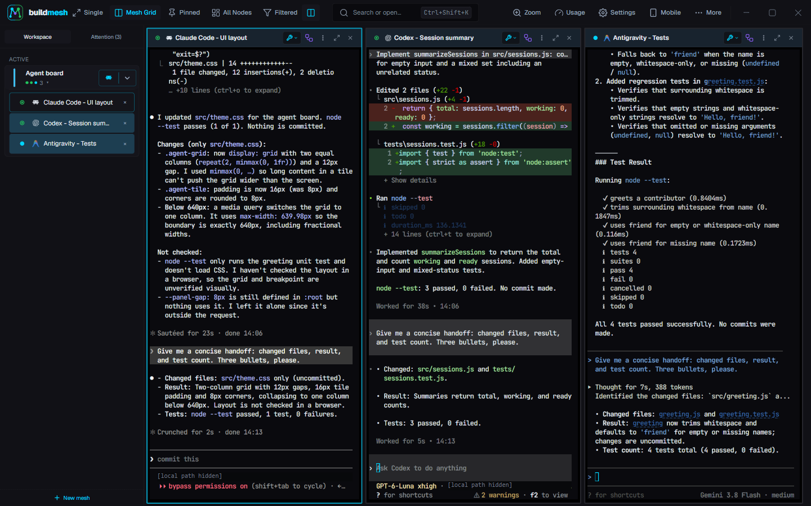
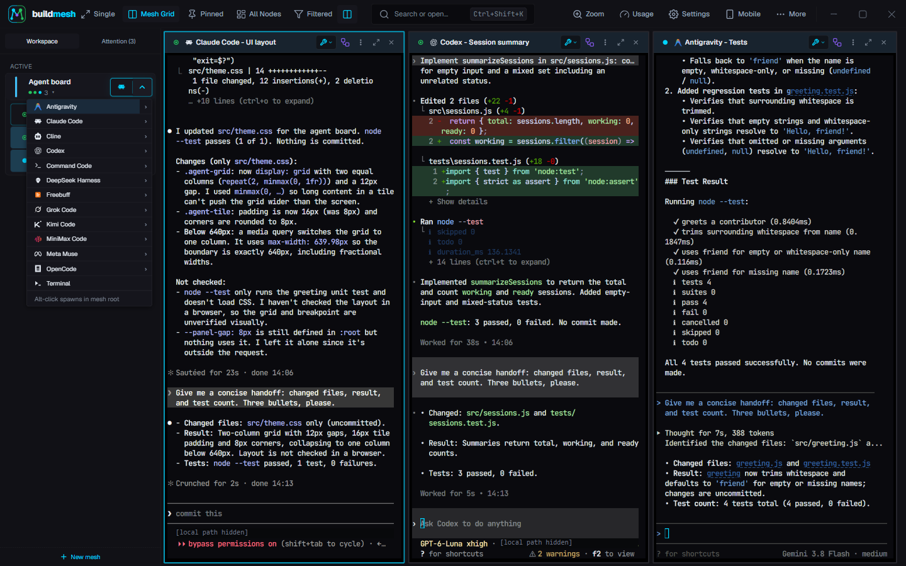
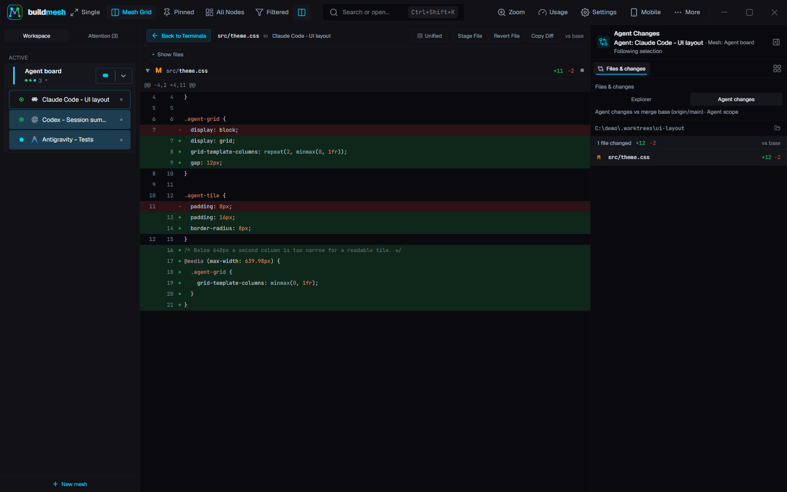

<h1 align="center">
  <picture>
    <source media="(prefers-color-scheme: dark)" srcset="./docs/brand/wordmark-on-dark.png" />
    
  </picture>
</h1>

Run AI coding agents side by side in persistent terminals, with Git worktrees keeping their changes apart.
If you use Claude Code / Antigravity / OpenCode from your shell and find yourself `tmux`-ing, copy-pasting between tabs, or losing context when a long-running agent restarts — Buildmesh is what that should look like.

| Agent grid | Spawn menu | Changed files |
|---|---|---|
| [](docs/media/v1.4.0/grid.png) | [](docs/media/v1.4.0/spawn-menu.png) | [](docs/media/v1.4.0/changed-files.png) |

Buildmesh is a Tauri desktop app for orchestrating multiple AI coding agents — **Claude Code, Codex, Antigravity, OpenCode, Cursor, Grok Code, Kimi Code, MiniMax Code, DeepSeek Harness, Command Code, Freebuff, Cline, Meta Muse**, and a plain **Terminal** harness — across multiple meshes at the same time. It runs each agent as a durable process in a persistent xterm.js terminal, isolates work via Git worktrees, and exposes a tiled grid view so you can orchestrate them all at once.


[Watch the full-resolution video](docs/media/v1.4.0/buildmesh-demo.mp4) · [Start here / how to report](https://github.com/alondero/buildmesh/discussions/2251)

[](https://github.com/alondero/buildmesh/actions/workflows/build.yml)
[](https://github.com/alondero/buildmesh/releases/latest)

## Start here

- **New users:** follow the [first-session user guide](docs/user-guide.md#your-first-session).
- **Something is wrong:** check [Troubleshooting](docs/troubleshooting.md).
- **Contributors:** read the [developer guide](docs/development/README.md) and [contribution contract](CONTRIBUTING.md).
- **Maintainers:** use the [release guide](docs/development/releasing.md), [release notes](docs/releases/README.md), and [documentation standards](docs/documentation-standards.md).

### Download

Grab the latest installer from the [GitHub Releases page](https://github.com/alondero/buildmesh/releases/latest). Each release publishes **two** Windows installers (pick whichever you prefer) and **two** macOS DMGs. macOS builds are early access; choose the artifact for your Mac's processor:

| File | Platform | Format | Notes |
|---|---|---|---|
| `Buildmesh_<version>_x64-setup.exe` | Windows x64 | NSIS `.exe` | Smallest download; per-user install. |
| `Buildmesh_<version>_x64_en-US.msi` | Windows x64 | Windows Installer `.msi` | MSI deployment; per-machine install. |
| `Buildmesh_<version>_aarch64.dmg` | macOS Apple Silicon | `.dmg` | Early-access build for arm64 Macs; drag **Buildmesh** to Applications. |
| `Buildmesh_<version>_x64.dmg` | macOS Intel | `.dmg` | Early-access build for Intel Macs; drag **Buildmesh** to Applications. |

The `.app.tar.gz` updater archives, rather than the DMGs, ship with `.sig` files used by the **in-app updater**. SHA-256 checksum manifests cover the downloadable DMGs and updater archives: `SHA256SUMS.txt` (Windows), `SHA256SUMS-macos-aarch64.txt`, and `SHA256SUMS-macos-x86_64.txt` (macOS).

## Install Buildmesh

Buildmesh ships as a Windows installer or a macOS `.dmg` through GitHub Releases. The macOS download is free and does not require an Apple Developer membership. Each release publishes an updater feed, and the app's in-app updater checks a minisign signature before installing an update. That signature protects update integrity; it does not identify Buildmesh as an Apple-trusted publisher. macOS apps are signed ad hoc, without an Apple Developer ID certificate or notarization, so Gatekeeper approval is expected on first launch.

On macOS, open the downloaded DMG, drag **Buildmesh** to **Applications**, then eject the disk image. Launch Buildmesh from Finder or Dock. Follow [Apple's current steps for opening an app from an unidentified developer](https://support.apple.com/guide/mac-help/open-a-mac-app-from-an-unknown-developer-mh40616/mac) if Gatekeeper blocks it. Do not turn off Gatekeeper globally. The [Tauri ad-hoc signing guidance](https://v2.tauri.app/distribute/sign/macos/#ad-hoc-signing) explains what this signature does and does not establish.

To check the download, get the matching `SHA256SUMS-macos-aarch64.txt` or `SHA256SUMS-macos-x86_64.txt` from the same release. Run `shasum -a 256` on the DMG and compare its digest with that DMG's row in the manifest. Each manifest also lists the updater archive; it is normal for a checksum command over the whole manifest to report that archive missing if you downloaded only the DMG.

### Supported platforms

| Platform | Status | How to get it |
|---|---|---|
| **Windows 10/11** (x64) | **Early access** — installer shipped on every tag. | Download from the Releases page above. |
| **WSL2** (hybrid Windows/WSL mode) | **Early access** on Windows 10/11 hosts — Linux agents run inside WSL2, the Windows-side backend drives the UI. | Install Windows first, then enable WSL2 from Mesh settings. |
| macOS (Apple Silicon + Intel) | **Early access** — native DMGs and updater metadata are published for both architectures. Downloaded-app installation, Gatekeeper/Finder launch, CLI workflows, session resume, and in-app updates still need native Mac runtime evidence; no minimum macOS version is claimed from compilation alone. | Download the `.dmg` matching your Mac from the Releases page above, install it in Applications, then use Apple's approval steps if Gatekeeper blocks first launch. |
| Linux (Ubuntu) | **Preview** — no release artifacts yet; the bundle compiles in CI. | [Build from source](#build-from-source). |

### First-run prerequisites

Buildmesh itself has no host dependencies — it bundles WebView2 on Win 11 and ships the React UI as a Tauri webview. The **agents** you spawn are a separate question:

- **`Terminal` harness** — works out of the box (PowerShell on Windows; routed through `wsl.exe` on WSL meshes).
- **Every other harness** — install the agent CLI on the host (or inside WSL for a WSL mesh), then sign in or add an API key from **App Settings → Providers**. Buildmesh detects the CLI binary on `PATH` and surfaces enabled harnesses in the Spawn Menu.

Buildmesh shows one entry per detected harness, preferring the host's native installation. On Windows, it also checks the default WSL distribution and adds **(WSL: distribution)** entries only for harnesses absent natively, such as Muse. Native Windows harnesses can run in WSL-backed meshes too. When Buildmesh itself runs inside WSL, Windows-only installations appear as **(Windows)** entries if Windows interoperability and `powershell.exe` are available. Restart Buildmesh after installing or removing a harness. Sign in inside the selected runtime. Cross-runtime worktrees stay managed by Buildmesh; use Buildmesh to remove them. WSL-backed repositories must be trusted by Windows Git, and Windows harnesses must support network-share paths. Muse supports fresh prompts and session resume; transcript display and turn-completion hooks are not yet available. Cross-runtime Grok attention hooks require mirrored networking. Process sandboxing cannot contain a harness across the Windows/WSL boundary.

On macOS, install and sign in to the CLI in your macOS user account before opening Buildmesh. Finder and Dock launch a different environment from an interactive shell; Buildmesh records the resolved executable path when it detects a CLI, but each CLI still needs a native launch check before it can be described as verified. A plain Terminal node has no provider session to resume.

- **(Optional) `gh` CLI** — only required for the GitHub Issues / PR features.
- **(Optional) WSL2** — only for hybrid Windows/WSL meshes.

### SmartScreen & Gatekeeper warnings

Windows installers are not signed with a trusted publisher identity. The macOS app carries an ad-hoc code signature, which does not provide Apple publisher trust or remove Gatekeeper approval. These first-launch checks are separate from the in-app updater, which uses Buildmesh's minisign key to check update integrity. To approve the app:

- **Windows (SmartScreen)** — *"Windows protected your PC … unknown publisher."* Click **More info → Run anyway**.
- **macOS (Gatekeeper)** — use [Apple's current approval steps](https://support.apple.com/guide/mac-help/open-a-mac-app-from-an-unknown-developer-mh40616/mac) for your macOS version. Depending on the version, Control-click the app in Applications and choose **Open**, or use **System Settings → Privacy & Security → Open Anyway**. Approve Buildmesh for this app only; do not disable Gatekeeper globally.

The DMG's SHA-256 checksum detects a damaged or changed download. Minisign `.sig` files apply to updater archives; they are not Apple publisher signatures and are not a substitute for checking the DMG checksum. The full release verification procedure lives in [`docs/development/releasing.md`](docs/development/releasing.md).

### Data location, logs, backup, uninstall

Buildmesh stores everything under a single per-profile directory. The stable and dev profiles are independent and use different bundle identifiers (`com.alond.buildmesh` vs `com.alond.buildmesh.dev`), so they can be installed side-by-side without colliding.

- **Windows stable** — `%APPDATA%\com.alond.buildmesh\`
- **Windows dev profile** — `%APPDATA%\com.alond.buildmesh.dev\`
- **macOS stable** — `~/Library/Application Support/com.alond.buildmesh/`
- **macOS dev profile** — `~/Library/Application Support/com.alond.buildmesh.dev/`

Inside:

| Path | Contents |
|---|---|
| `buildmesh.db` | SQLite database (meshes, Agent Nodes, settings). |
| `snapshots\` | Automatic state snapshots (newest 3 kept). One is taken before each schema upgrade. |
| `preferences.json` | Provider accounts, launch configurations, worktree directory. |
| `tls\` | LAN HTTPS certificate chain, including the root CA private key. |
| `logs/buildmesh.log` | Rotating Rust + frontend log, size-bounded and name-stable. On macOS, open the stable profile folder in Finder from **Settings → Data & Diagnostics → Open data folder**, then open `logs/buildmesh.log`. |
| `logs\panic.log` | External crash-watchdog dump (Windows only). |
| `circuits\finish.md` | Shared Circuit wrap-up template. |

On Windows, OAuth secrets and provider API keys are stored in **Windows Credential Manager** when available. macOS has no Buildmesh credential-store integration, so provider keys configured in Buildmesh remain in `preferences.json` in the profile folder. Treat that folder as sensitive.

**Back up and restore from inside the app.** **Settings → Data & Diagnostics**
checks your stored state, takes snapshots, and exports a portable copy with
credentials left out by default — see the
[user guide](docs/user-guide.md#data-backup-and-restore). A pre-upgrade snapshot
is taken automatically, so a schema upgrade is always reversible. A folder copy
of this directory is *not* a substitute: it includes `tls\ca.key.der`, the
private key for the HTTPS identity your paired devices trust.

To **uninstall** Buildmesh and **remove all user data**: uninstall from *Windows Settings → Apps → Installed apps → Buildmesh → Uninstall*, **then** delete the profile directory above. The MSI/NSIS uninstaller removes the binary and registry entries but does **not** delete the data dir, so the two-step matters if you want a clean slate. Export first if you want to keep anything.

### Upgrade

Installed apps check the release updater feed on launch and surface an *"Update available"* prompt. Windows uses the in-app updater for supported releases. The macOS updater path is part of early access and has not yet been confirmed on both native architectures; if an update is unavailable or fails, download the newer DMG and drag its **Buildmesh.app** over the copy in Applications. Locally-built dev builds disable the updater via their `.dev` bundle identifier.

To upgrade manually on Windows, install the new `.msi` or `-setup.exe` over the existing install — both installers support in-place upgrade. On macOS, drag the new `Buildmesh.app` from the newer `.dmg` over the one in Applications. Do not infer that the in-app update path worked from a successful DMG build.

### Get help

- **Bug or unexpected behaviour?** Open an issue using the [bug template](.github/ISSUE_TEMPLATE/bug.md). Include the contents of `logs\buildmesh.log` for the relevant session and your version (from *Help → About*, or the installer filename).
- **Feature request?** Use the [feature template](.github/ISSUE_TEMPLATE/feature.md).
- **Question / "how do I…"** — open a [GitHub Discussion](https://github.com/alondero/buildmesh/discussions) (or an issue with no template).
- **Security vulnerability** — **do not** file a public issue; report privately through [GitHub Security Advisories](https://github.com/alondero/buildmesh/security/advisories/new). See [`SECURITY.md`](SECURITY.md) for the supported-versions policy and response timeline.

## Features

### Multi-agent orchestration
- **Fourteen harnesses, one workflow**: Claude Code, Codex, Antigravity, OpenCode, Grok Code, Cursor, Kimi Code, MiniMax Code, DeepSeek Harness, Command Code, Freebuff, Cline, Meta Muse, and a plain `Terminal` harness — switch harnesses per Agent Node. Some harnesses pair with a *Model Provider* (Anthropic, MiniMax, Kimi) so each Agent Node can carry live quota / balance widgets; custom Claude-compatible endpoints attach as proxied providers.
- **Multi-mesh workspaces**: open several meshes side by side. Each mesh is its own grid of agent terminals.
- **Tiled grid view**: split each mesh into a 1–6 pane grid. Layouts are saved per mesh.
- **Persistent terminals**: agents run as durable background processes and their PTY state survives mesh and pane switches. Quitting the app prompts you to confirm when there are non-resumable sessions; on relaunch anything still running is restored automatically and anything suspended shows up in the Resume menu. The plain `Terminal` harness and any harness that hasn't yet captured a session id are **non-resumable** — exiting loses their progress.
- **Git worktree isolation**: every agent node gets its own worktree branch, so concurrent agents on the same repo never collide.

### Productivity
- **Attention hook**: agents raise a notification when they need your input. Buildmesh listens for `idle_prompt` events on the Claude Code side and surfaces a "needs input" badge in the sidebar — no polling, no timers.
- **Auto-named nodes**: nodes spawned from an issue, a pull request, or an Autopilot Circuit are named after it straight away (e.g. `gh123-fix-login`); other agent nodes with readable conversations are auto-named from their initial task (LLM-generated slug) so a 10-agent swarm stays readable.
- **Session resume**: surviving processes and stored `cli_session_id`s mean a restart resumes where you left off. Crash recovery marks `Running` nodes as `Suspended` on startup.
- **Build & run**: per-mesh build/run commands with auto-detection for Rust, Node, Tauri, JVM, Go, and Python projects.
- **Terminal zoom slider**: a *Zoom* button in the title bar opens a text-size slider for every terminal pane (agent and build/run alike). It stays in step with the `Ctrl/Cmd +` / `Ctrl/Cmd -` / `Ctrl/Cmd 0` shortcuts and the `Ctrl`/`Cmd` + mouse-wheel gesture, and your chosen size is remembered across launches.

### Visibility & review
- **Notifications**: the bell immediately left of Zoom opens a resizable side panel with worktree problems first and recent toast history below. Toasts stay reviewable after dismissal. Choose Resolve to inspect or retry a blocked worktree cleanup; failures no longer interrupt you with a modal. Mark all read and Clear read keep unresolved problems visible.
- **File explorer with inline diff**: per-mesh and per-node file trees with line-addition/deletion counts and a side-by-side diff viewer.
- **Changed Files panel**: aggregated view of modified files across the whole mesh.
- **Mesh-level PR creation**: uncommitted-changes indicator + `gh pr create` from Mesh Properties.
- **GitHub Issues integration**: triage, view, and spawn an agent on an issue without leaving the app.
- **Accounts & Usage panel**: per-provider quota tracking for the providers that expose a usage endpoint.

### Power features
- **Remote access**: pair a phone over HTTPS with a single-use QR code or pairing code. The browser remembers its device session and reconnects automatically; revoke individual phones in Authorized Devices. Disabling LAN access closes active remote connections. WebSocket PTY relay streams terminals to your phone, with port fallback (1992→1993→1994).
- **Native Android client**: manage agents, capture tasks, triage issues and their labels (including Autopilot tags), start agents from a mesh, an issue or a pull request with the same launch menu as the desktop, browse archives, inspect diffs, create pull requests and use live terminals. Pair with the desktop QR; device credentials are encrypted on the phone. A signed `Buildmesh_<version>_android.apk` is published on each [release](https://github.com/alondero/buildmesh/releases) next to the Windows installers — download and sideload it, or [build one yourself](docs/development/android.md#build-and-install).
- **AI context portability**: share `CLAUDE.md`, `.claude/skills`, and friends with Codex, OpenCode, and Antigravity via `AGENTS.md` + `.agents/skills` git symlinks — no per-provider duplication.
- **Dev / Stable side-by-side profiles**: run an in-development build (`buildmesh-dev`) without interrupting the stable hub you orchestrate agents from.

## Project folders and launch recovery

Meshes can select a repository subfolder. With worktrees enabled, Buildmesh
checks out the containing repository and starts the agent in the matching
folder, preserving its scoped instructions. Worktree directory settings still
control the checkout location. Without worktrees, the agent starts directly in
the selected folder. Git diffs and cleanup cover the complete checkout.

If the selected starting ref lacks that folder, launch reports the missing
folder and ref once. Restore the folder in that checkout, or create a new node
from a ref containing it. After resolving other launch errors, use Restart or
Start Fresh. Failed automatic launches stay in the error state; reopening
the terminal does not retry them. Existing nodes retain their saved checkout
location and starting directory on resume.

## Agent sandboxing (security, experimental)

> **Not a released feature.** Confinement is incomplete and platform-dependent,
> so the sandbox is hidden behind a developer flag and ships disabled. Start
> Buildmesh with `BUILDMESH_SANDBOX=1` to reveal the per-Mesh **Sandbox**
> toggle; without that variable the setting is stored but never applied, so
> agents run unconfined. Do not rely on it as a security boundary yet.

A prompt-injected or runaway agent runs real shell commands on your machine.
When a developer opts in, each **Mesh** can enable **Sandbox agent processes**,
which wraps that mesh's agent processes in the host OS's native confinement.
The toggle is read at spawn time, so flipping it never disturbs already-running
agents. What you actually get differs sharply by platform:

| Launch target | What the sandbox does |
|---|---|
| **macOS** (native) | Seatbelt confinement to the node's worktree: read/write there, everything else denied by default. Fails **closed** — if the profile cannot be written the spawn is refused rather than run unconfined. |
| **Windows** (native) | A **restricted token**: process restrictions plus network and loopback reach. It does **not** deny filesystem reads or writes, so it is not worktree confinement. |
| **Linux** | **Nothing.** No backend exists; the toggle is inert. |
| **WSL / cross-runtime** | **Not contained.** A host sandbox cannot confine a guest process, so the toggle does not apply to WSL-backed launches. |

On macOS the Windows table's caveat applies only to the restricted-token
backend: Seatbelt *is* deny-by-default for the filesystem. Its own limits still
apply — the agent keeps network egress (it needs the model API), and the exact
set of system read paths a given toolchain needs is verified on real hardware
rather than in CI.

The Windows backend was pivoted off a per-node AppContainer: the AppContainer's
private object namespace hung `claude.exe` at libuv's named-pipe creation and
blocked loopback. The restricted token fixes both. Deny-by-default **read/write
confinement** on Windows is still deferred — a same-user restricted token
can't deny home reads while MSYS `bash` runs (both are secured by the same user
SID), so the surviving path is a separate low-privilege user principal (or WSL).

### Attention hooks

Separately from the sandbox, spawning a node writes an attention hook into the
harness's own configuration, and that hook POSTs lifecycle events to the local
app over loopback HTTP. The exact files, where they land, and what the request
carries are listed in [Attention hooks Buildmesh installs on
disk](docs/user-guide.md#attention-hooks-buildmesh-installs-on-disk).

### What it is *not*

- **Not a container or VM.** It's an OS access-control boundary on a single process tree, not virtualization or namespacing.
- **Not network egress control.** A sandboxed agent still reaches the internet (it has to, for the model API) — the sandbox limits *filesystem and host* access, not where data can be sent.
- **Not a guarantee the agent binary is trustworthy.** It confines what the agent process can touch; it doesn't vet the agent or its dependencies.
- **Not cross-runtime.** It cannot contain a process running inside WSL from a Windows host, or vice versa.

### Harness permission modes

Separately from the sandbox, each harness has a **Permission mode** in
**Settings → Launch Configurations → Agent Harness defaults**: its auto/unattended mode
(the harness's own flag, e.g. Claude Code's
`--dangerously-skip-permissions`) or prompt mode (launch the CLI bare so it
asks). Buildmesh passes the flag through unchanged — what acts is the agent;
Buildmesh only facilitates the launch. The effective mode shows in the
harness's own words on its Settings card;
changing it changes the next spawn's arguments, and existing meshes keep
today's unattended behavior until you change it. Full details, including the
per-harness flag table, are in [Harness permission
modes](docs/user-guide.md#harness-permission-modes).

## Keyboard shortcuts

- `Ctrl + T` / `Cmd + T` — new agent node
- `Ctrl + Alt + ←/→/↑/↓` / `Cmd + Option + ←/→/↑/↓` — traverse the on-screen node grid (wrap within row; Up/Down no-op when there's only one row; from a maximized solo view, the first press restores the grid). Uses two modifiers so the readline `backward-word` / `forward-word` gesture in any focused agent terminal (bash, zsh, fish, PSReadLine, REPLs) still works.
- `Ctrl + 0` / `Cmd + 0` — reset terminal font size
- `Ctrl + +` / `Cmd + +` — increase terminal font size
- `Ctrl + -` / `Cmd + -` — decrease terminal font size
- `Alt + G` / `Cmd + G` — toggle grid ↔ single view (maximize the active node or restore the split; no-op when there is no active node)

The `Ctrl` modifier shown above is `Cmd` on macOS — Tauri normalises
`CommandOrControl+…` registrations and JSX labels use `isMac ? '⌘' : 'Ctrl'`,
so every binding works the same way on Windows, Linux, and macOS.

## Tech stack

- **Frontend** — React 19, Zustand 5, xterm.js 6, Tailwind 4, TypeScript ~5.8, Vite 7
- **Backend** — Tauri 2, Rust, `portable-pty`, `rusqlite` (SQLite), `git2`
- **Persistence** — local SQLite (`app_settings`, `meshes`, `agent_nodes`)
- **Runtime** — Windows 10/11, with optional WSL2 support; macOS ships as an ad-hoc-signed app
- **Testing** — Vitest (unit + integration) + Playwright (e2e)

## Build from source

This section is for contributors and for users on macOS/Linux (Linux is not published as a release yet, and macOS is — see [Supported platforms](#supported-platforms)).

### Prerequisites

- **Node.js 20+ (LTS)** and **npm**
- **Rust stable** (1.74+, the minimum Tauri 2 supports)
- **Platform deps** — see [Tauri 2 prerequisites](https://tauri.app/start/prerequisites/) for your OS
  - Windows: WebView2 runtime (preinstalled on Win 11), Microsoft C++ Build Tools
  - macOS: Xcode Command Line Tools
  - Linux: `webkit2gtk`, `libssl-dev`, `libgtk-3-dev`, `libayatana-appindicator3-dev`, `librsvg2-dev`
- **Git CLI** — used for worktree ops, branch handling, and the optional GitHub Issues / PR features
- **(Optional) WSL2** — required only if you want the hybrid Windows/WSL runtime
- **(Optional) `gh` CLI** — only if you want the GitHub Issues and PR features authenticated

### Install

```bash
npm install
```

### Develop

```bash
npm run tauri dev
```

This launches the Tauri shell + Vite dev server. First run takes a few minutes while the Rust backend compiles.

### Build a release binary

```bash
# Stable profile (com.alond.buildmesh). Phone and Android use port 1992.
npm run tauri build

# Dev profile (com.alond.buildmesh.dev, phone and Android on port 2992) — runs side-by-side with stable
npm run tauri:build:dev
```

Binaries land in `src-tauri/target/release/`:

| Profile | Binary | Phone / Android HTTP |
|---|---|---|
| Stable | `buildmesh.exe` | 1992 (fallback 1993→1994) |
| Dev | `buildmesh-dev.exe` | 2992 (fallback 2993→2994) |

The development test bridge is a separate loopback listener on port 1991 (2991 for the dev profile). The release entry points do not pass the `dev-tools` feature that compiles it. A debug or dev-tools build listens only when started with `BUILDMESH_TEST_BRIDGE=1` and a per-launch token (`scripts/run-dev.ps1 -TestBridge` or `scripts/run-dev.sh --test-bridge`).

The dev profile is what `/use` and `/verify` use — it never touches the stable hub. Run from a linked worktree, the launcher gives that worktree its own ports and its own app-data profile, and stops only the instance it launched before, so several worktrees can each verify their own build at once. It prints the `Dev ports:` and `Dev profile:` it chose; set `BUILDMESH_PORT_OFFSET` or `BUILDMESH_PROFILE_DIR` to pin either.

## Test

```bash
npm test                 # unit + integration
npm run test:docs        # documentation contract tests
npm run check:docs       # local links, anchors, required docs, source drift
npm run test:e2e         # Playwright e2e (dev-tools build, authenticated bridge on :1991)
npm run test:ci          # all three in one go
cargo test               # Rust unit tests (run inside src-tauri/)
```

## Bundle size budget

The desktop entry chunk (`dist/assets/index-*.js`) is the single largest
byte-cost on first paint. After the lazy-xterm + lazy-Probe-tab
split, it sits at roughly 894 kB minified / 274 kB gzip — with xterm and
its five addons (≈430 kB / ≈100 kB gzip) only fetched the first time a
terminal pane is opened, and each Probe tab (≈2–24 kB / ≈1–7 kB gzip)
only fetched when the user actually opens that destination.

The build is gated by [`scripts/check-bundle-size.mjs`](scripts/check-bundle-size.mjs)
against the **budget limits** in [`scripts/bundle-budget.json`](scripts/bundle-budget.json):

| Asset | Budget limit (raw) | Budget limit (gzip) |
|---|---|---|
| `dist/assets/index-*.js` | 1.05 MB | 360 KB |
| `dist/assets/index-*.css` | 117 KB | 20 KB |

The numbers above are **upper bounds**, not the current size — the
table deliberately leaves headroom (~20% raw, ~30% gzip) so a typical
regression surfaces as a visible budget breach instead of a cliff-edge
green/red flip. Run `npm run check:bundle` after `npm run build` to see
the current numbers and the headroom remaining.

```bash
npm run build           # produces dist/
npm run check:bundle    # reads dist/ and compares against scripts/bundle-budget.json
```

The budget says how large the entry chunk may get, but not what belongs in
it. [`scripts/check-bundle-composition.mjs`](scripts/check-bundle-composition.mjs)
is the second half of the gate: it asserts that xterm + its addons and every
Probe tab are still split into their own lazy chunks, so re-importing one
eagerly fails the build instead of quietly re-growing the entry chunk under a
raised budget. It reads the same `dist/` and fails with the offending import and the
file that pulled it in.

```bash
npm run check:bundle-composition   # reads dist/ and fails if a lazy chunk was inlined
```

`scripts/check.ps1 all-ts` (and `all`) runs both checks as part of the green
bar — `unit` / `integration` / `rust` skip them because they don't produce a
build. `npm run verify` runs both too, as the `bundle` and `bundle-composition`
harness gates. The quality job on CI runs them after `npm run build` so a
regression on the entry chunk fails the build. Bump the budget values
intentionally — every visible CI failure costs a hot path; don't paper over a
real growth by raising the ceiling. If the gate instead reports that a lazy chunk has gone
missing after a deliberate build-config change, update its forbidden list
rather than deleting the check.

## Project structure

```
buildmesh/
├── src/                       # React frontend
│   ├── components/            # Terminal, Sidebar, FileTree, Probe, …
│   ├── stores/                # Zustand stores
│   └── lib/                   # shared utilities
├── src-tauri/
│   ├── src/
│   │   ├── commands/          # Tauri command handlers (#[command])
│   │   ├── agent/             # spawn logic + provider adapters
│   │   │   └── provider/adapters/   # one file per provider (anthropic, minimax, kimi, …)
│   │   ├── db/                # SQLite schema + migrations
│   │   ├── env/               # Windows/WSL path translation
│   │   ├── http/              # attention webhook + remote-access routes
│   │   └── session_naming.rs  # Conversation-based LLM node naming
│   ├── tauri.conf.json        # stable profile config
│   └── tauri.dev.conf.json    # dev-profile overlay (identifier *.dev, port +1000)
├── tests/
│   ├── unit/                  # Vitest unit tests
│   ├── integration/           # Vitest integration tests
│   └── e2e/                   # Playwright e2e tests
├── docs/
│   ├── knowledge-primer.md    # architecture, conventions, anti-patterns (read first)
│   ├── adr/                   # Architecture Decision Records
│   └── specs/                 # feature specs
├── CONTEXT.md                 # domain language (read alongside knowledge-primer.md)
├── AGENTS.md                  # portable AI-context for non-Claude agents
└── CLAUDE.md                  # AI-agent rules (token-efficient, do not bloat)
```

## Documentation

- **[`docs/`](docs/)** — documentation hub and audience-based navigation.
- **[`docs/user-guide.md`](docs/user-guide.md)** — first session, harness capabilities, worktrees, settings, and remote access.
- **[`docs/troubleshooting.md`](docs/troubleshooting.md)** — common detection, runtime, connectivity, and recovery problems.
- **[`docs/development/`](docs/development/)** — setup, verification, architecture boundaries, and release operations.
- **[`docs/documentation-standards.md`](docs/documentation-standards.md)** — what must be documented when behavior changes.
- **[`docs/knowledge-primer.md`](docs/knowledge-primer.md)** — architecture, conventions, anti-patterns. Read this before touching backend, terminal, agent-spawn, or path code.
- **[`CONTEXT.md`](CONTEXT.md)** — domain language and mental model (what a "Mesh" is, what an "Agent Node" is, how they relate).
- **[`docs/adr/`](docs/adr/)** — Architecture Decision Records.
- **[`docs/specs/`](docs/specs/)** — feature specs and PRDs.
- **[`CLAUDE.md`](CLAUDE.md)** — AI-agent rules (token-efficient; not a human onboarding doc).

## Contributing

See [CONTRIBUTING.md](CONTRIBUTING.md) for the dev loop, commit conventions,
harness-enforced rules, and the triage workflow.

## License

[MIT](LICENSE) — Copyright (c) 2026 Adam Londero.
