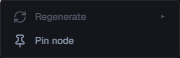
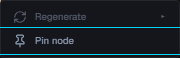

# Dependabot #2405: menu focus regression

The dependency upgrade to jsdom 30 exposed Chromium-aligned behavior: calling `focus()` on a native-disabled button does not move focus.

| Before (`cf8e5e61688af16b80f35ef86500faa7e3890538`) | After (`a83d5cf114ebb454f4cd99abe85915661f849797`) |
|---|---|
|  |  |

Mock Chromium fixture: the default UI mock with node `fix-terminal-blank` set to `spawning`. The interaction opens its context menu, checks disabled Regenerate and initial focus, presses ArrowDown, ArrowUp, Home and End, checks Escape restores focus to the row, then reopens the menu and checks focus and ArrowDown again. The baseline kept focus on a child span in the node row, left Pin at `tabindex=-1`, ignored all navigation keys, and left the menu open on Escape. The repaired build focuses Pin and passes each interaction assertion.

Capture time: baseline 15.9 s using the pinned isolated review checkout; repaired build 9.7 s. The mock exercises the real frontend in Chromium with fixture IPC; it does not exercise the Rust backend.
